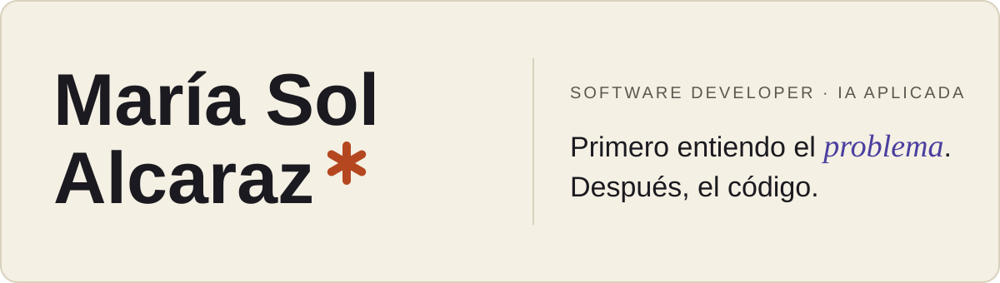

<picture>
  <source media="(prefers-color-scheme: dark)" srcset="assets/cabecera-oscuro.svg">
  
</picture>

  <a href="https://solalcaraz.github.io"><b>Portfolio</b></a> &nbsp;·&nbsp;
  <a href="https://linkedin.com/in/maria-sol-alcaraz"><b>LinkedIn</b></a> &nbsp;·&nbsp;
  <a href="https://solalcaraz.github.io/cv/CV-Maria-Sol-Alcaraz.pdf"><b>CV</b></a>

## Sobre mí

Software Developer en Buenos Aires, Argentina. Armo sitios, sistemas y herramientas pensando en quién los va a usar.

En 2026 entregué dos webs con panel de administración. Lo que más me importó no fue el código: fue que sus dueñas pudieran editarlas solas, sin romper nada. Antes de escribir una línea, ordeno qué problema hay, qué hace falta y qué no.

Tecnicatura en Programación Informática, UNSAM (cursada finalizada).

## Lo que construí

### Calis Trainer
**Trabajo freelance · Sitio web + panel de administración · Agosto – septiembre de 2026**

Web de una entrenadora de calistenia, con un panel en español pensado para quien no programa: las páginas principales no se pueden borrar, cada foto pide descripción y no se aceptan videos de más de 15 segundos. Al publicar, la web se regenera sola en uno o dos minutos. La identidad de marca (paleta, tipografía, tono) la definí a partir de una investigación de mercado.

**Dato:** 99–100 en rendimiento y 100 en accesibilidad, buenas prácticas y SEO (Lighthouse en celular, sobre la portada; medición de laboratorio).

`Astro` `TypeScript` `Sanity` `Vercel` · [Ver la web](https://calis-trainer-web.vercel.app) · [Caso completo](https://github.com/solalcaraz/bang-ignore/tree/main/proyectos/calis-trainer) *(el código es privado: es trabajo de una clienta)*

### Polar Canvas
**Trabajo freelance · Sitio web + panel de administración · Julio – agosto de 2026**

Portfolio bilingüe (español e inglés) de una ilustradora y diseñadora, con un panel propio para que cambie obras, textos y fotos sin depender de mí. Login con Google (OAuth 2.0, flujo escrito a mano), guardado con control de conflictos y recorte de fotos en el navegador. El sitio público es estático y sin base de datos: el contenido vive en archivos versionados.

**Dato:** 20 pruebas end-to-end con Playwright, que cubren rutas públicas en los dos idiomas, acceso al panel, bloqueo de pedidos de otro origen y límites de frecuencia.

`Astro` `TypeScript` `React` `Cloudflare R2` `Playwright` `Vercel` · [Ver la web](https://web-polar-canvas.vercel.app) *(con contenido de muestra hasta que la clienta cargue el definitivo)* · [Caso completo](https://github.com/solalcaraz/bang-ignore/tree/main/proyectos/polar-canvas) *(código privado)*

### CRUDO
**Práctica del módulo de Claude Design (Triple A) · Landing + tienda con pago simulado · Noviembre de 2026**

Caso ficticio que trabajé como un encargo real: una marca de ropa urbana de edición limitada que vendía por Instagram. Sin plantilla: partí de un manual de marca y decidí la estructura, el tono y la jerarquía. Diseñé en Claude Design y dirigí a Claude Code, que pasó el diseño a código. Toda la animación se apaga con "reducir movimiento". Los datos y las fotos son de ejemplo, y no se vende nada.

**Dato:** 100 en accesibilidad, buenas prácticas y SEO; 88 (landing) y 86 (tienda) en rendimiento, con las fuentes de Google como mejora anotada.

`HTML` `CSS` `JavaScript` `Claude Design` `Claude Code` `Vercel` · [Ver la web](https://crudo-ropa-urbana.vercel.app) · [Caso completo](https://github.com/solalcaraz/comunidad-triple-a-claude-design/tree/main/caso-crudo)

### Remy
**Facultad, equipo de 5 · App web de recomendaciones · Marzo – julio de 2026**

App que recomienda recetas según tu despensa, tus restricciones alimentarias, tu objetivo y tu presupuesto, y explica por qué recomienda cada una. **Mi parte:** diseñé la lógica de recomendación (búsqueda semántica con pgvector y scoring explicable; el código del motor lo escribió una compañera a partir de ese diseño) y dejé lista la base de datos: armé el dataset de ingredientes con información nutricional de USDA, generé los embeddings y migré todo a Flyway. Después, en mi fork, corregí errores y cerré dos problemas de seguridad.

**Dato:** 108 ingredientes y 81 recetas con 243 pasos; embeddings de 768 dimensiones.

`Kotlin` `Spring Boot` `PostgreSQL` `pgvector` `React` `TypeScript` · [Backend](https://github.com/solalcaraz/back-remy-app) · [Frontend](https://github.com/solalcaraz/front-remy-app)

### BookLibre
**Facultad, equipo de 5 · Plataforma de préstamo de libros · Marzo – junio de 2026**

App para prestar y reservar libros entre lectores, con tres bases de datos coordinadas en una misma operación (PostgreSQL, MongoDB con sharding y Redis) y una API REST y GraphQL. **Mi parte:** el home con búsqueda, filtros y paginado; la persistencia con JPA y los permisos por rol; los endpoints sobre MongoDB; y la caché en Redis con el leaderboard por GraphQL. Después, en mi fork, uní los dos repos y corregí errores heredados. Hoy no está online.

**Dato:** con 10.000 libros, la sección de populares con Redis responde en 11,6 ms contra 25,1 ms de la búsqueda normal (54 % menos); con 100.000, en 12,3 ms contra 170,5 ms (93 % menos). Medido en una compu de desarrollo, con datos de prueba.

`Kotlin` `Spring Boot` `PostgreSQL` `MongoDB` `Redis` `GraphQL` `React` · [Repositorio](https://github.com/solalcaraz/booklibre)

## Stack, y dónde lo usé

| | Tecnologías | Dónde |
|---|---|---|
| **Backend** | Kotlin, Spring Boot, Spring Security | BookLibre, Remy, Algo Que Pedir |
| | Java | Cursos de TodoCode y Codo a Codo |
| | Python, FastAPI | Detección de anomalías en transacciones |
| | Node.js | Postulaciones |
| **Frontend** | React, TypeScript | BookLibre, Remy, Algo Que Pedir, Polar Canvas |
| | Astro, Tailwind CSS | Calis Trainer, Polar Canvas, mi portfolio |
| | Svelte | Algo Que Pedir |
| **Datos** | PostgreSQL, pgvector, Flyway | Remy, BookLibre |
| | MongoDB, Redis | BookLibre |
| **Servicios** | Sanity, Cloudflare R2, Google OAuth 2.0 | Calis Trainer, Polar Canvas |
| **Pruebas** | Playwright, Vitest, Kotest, JUnit | Polar Canvas, Algo Que Pedir, BookLibre |
| **Entrega** | Docker, GitHub Actions, Vercel, Git | Casi todos los proyectos |
| **IA** | Embeddings y búsqueda semántica | Remy |
| | Detección de anomalías con scikit-learn | Detección de anomalías en transacciones |
| | Claude Code, skills y MCP | Ver abajo |

## Cómo trabajo con IA

Uso Claude Code como herramienta de desarrollo. **Yo defino el problema, el alcance y las decisiones; Claude Code ejecuta, y yo reviso y audito lo que hace.** No presento ese código como escrito a mano: lo mío es decidir y verificar.

- **Un `CLAUDE.md` por proyecto** con el alcance, las decisiones ya tomadas y lo que queda afuera, para no repetir indicaciones.
- **Cambios de a uno**, probados en el navegador y en celular antes de seguir.
- **Verifico lo que dice la IA.** Así encontré un formulario que abría WhatsApp dos veces, un dominio que daba por libre y un mapa que no cargaba.
- **Manejo de skills y de MCP** para extender lo que Claude puede hacer, siempre con una persona revisando antes de que algo se envíe.

## Más proyectos

<!-- PROYECTOS:INICIO -->
<!-- Esta tabla la genera una acción de GitHub desde https://solalcaraz.github.io. No editar a mano. -->

| Proyecto | Qué es | Fecha |
|---|---|---|
| [Postulaciones](https://github.com/solalcaraz/bang-ignore/tree/main/proyectos/postulaciones) | Herramienta personal | Última actividad: noviembre de 2026 |
| [El Fogón de Don Nino](https://github.com/solalcaraz/comunidad-triple-a-claude-code/tree/main/web-fogon-nino) | Landing page con carta editable | Período: Noviembre de 2026 |
| [Estudio Verde](https://github.com/solalcaraz/comunidad-triple-a-claude-code/tree/main/web-estudio-verde) | Landing page | Período: Noviembre de 2026 |
| [Estudio Ferreyra & Asociados](https://github.com/solalcaraz/comunidad-triple-a-claude-code/tree/main/web-ferreyra) | Landing page + borradores de mail con Claude (MCP) | Período: Noviembre de 2026 |
| [Café Raíz](https://github.com/solalcaraz/comunidad-triple-a-claude-design/tree/main/cafe-raiz) | Landing page + tienda con pedido por WhatsApp | Período: Noviembre de 2026 |
| [Detector de anomalías en transacciones bancarias](https://github.com/solalcaraz/transacciones-db-api) | Análisis de datos con IA | Período: Agosto – noviembre de 2025 |
| [Algo Que Pedir](https://github.com/solalcaraz/algo-que-pedir) | Sistema de pedidos | Período: Marzo – noviembre de 2025 |

<!-- PROYECTOS:FIN -->

## Ahora

Estoy practicando agentes de Claude Code y Spring Security.

---

  Todo lo demás está en <a href="https://solalcaraz.github.io">solalcaraz.github.io</a>

