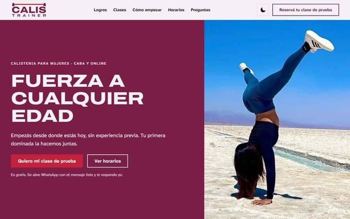
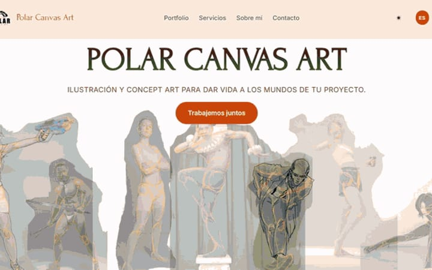
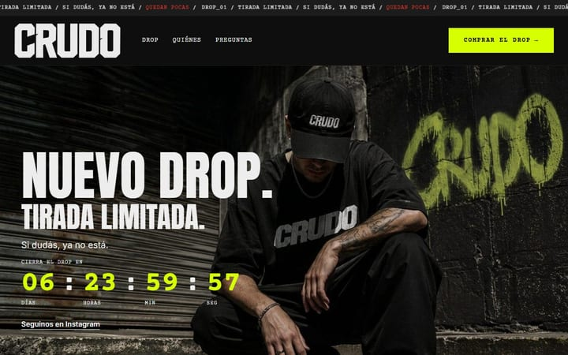
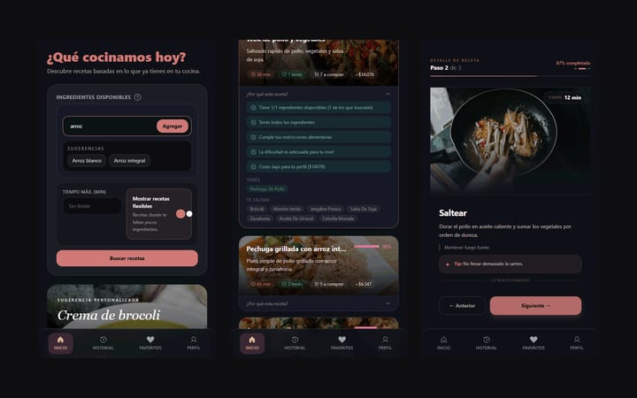
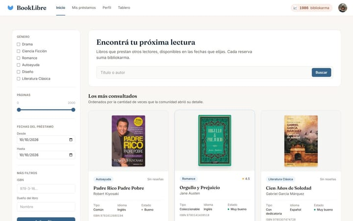

<picture>
  <source media="(prefers-color-scheme: dark)" srcset="assets/cabecera-oscuro.svg">
  
</picture>

  <a href="https://solalcaraz.github.io"><b>Portfolio</b></a> &nbsp;·&nbsp;
  <a href="https://linkedin.com/in/maria-sol-alcaraz"><b>LinkedIn</b></a> &nbsp;·&nbsp;
  <a href="https://solalcaraz.github.io/cv/CV-Maria-Sol-Alcaraz.pdf"><b>CV</b></a>

## Sobre mí

Software Developer en Buenos Aires, Argentina. Armo sitios, sistemas y herramientas pensando en quién los va a usar.

En 2026 entregué dos webs con panel de administración. Lo que más me importó no fue el código: fue que sus dueñas pudieran editarlas solas, sin romper nada. Antes de escribir una línea, ordeno qué problema hay, qué hace falta y qué no.

Tecnicatura en Programación Informática, UNSAM (cursada finalizada).

## Lo que construí

<table>
  <tr>
    <td width="40%" valign="top">
      
    </td>
    <td valign="top">
      <h3>Calis Trainer</h3>
      Trabajo freelance · Sitio web + panel de administración · Agosto – septiembre de 2026
      
Web de una entrenadora de calistenia, con un panel en español para que actualice el contenido ella sola. Al publicar, la web se regenera en uno o dos minutos.

      
<b>99–100 en Lighthouse móvil</b> (portada, medición de laboratorio).

      
<code>Astro</code> <code>TypeScript</code> <code>Sanity</code> <code>Vercel</code>

      
<a href="https://calis-trainer-web.vercel.app">Ver la web</a> · <a href="https://github.com/solalcaraz/bang-ignore/tree/main/proyectos/calis-trainer">Caso completo</a> (código privado: es trabajo de una clienta)

    </td>
  </tr>
  <tr>
    <td width="40%" valign="top">
      
    </td>
    <td valign="top">
      <h3>Polar Canvas</h3>
      Trabajo freelance · Sitio web + panel de administración · Julio – agosto de 2026
      
Portfolio bilingüe de una ilustradora, con panel propio: login con Google (OAuth 2.0 escrito a mano), control de conflictos al guardar y recorte de fotos en el navegador.

      
<b>20 pruebas end-to-end</b> con Playwright.

      
<code>Astro</code> <code>TypeScript</code> <code>React</code> <code>Cloudflare R2</code> <code>Vercel</code>

      
<a href="https://web-polar-canvas.vercel.app">Ver la web</a> (con contenido de muestra hasta que la clienta cargue el definitivo) · <a href="https://github.com/solalcaraz/bang-ignore/tree/main/proyectos/polar-canvas">Caso completo</a> (código privado)

    </td>
  </tr>
  <tr>
    <td width="40%" valign="top">
      
    </td>
    <td valign="top">
      <h3>CRUDO</h3>
      Práctica del módulo de Claude Design (Triple A) · Landing + tienda con pago simulado · Noviembre de 2026
      
Caso ficticio que trabajé como un encargo real: una marca de ropa urbana de edición limitada. Sin plantilla: diseñé en Claude Design y dirigí a Claude Code, que pasó el diseño a código. Los datos y las fotos son de ejemplo.

      
<b>100 en accesibilidad, buenas prácticas y SEO</b>; 88 y 86 en rendimiento.

      
<code>HTML</code> <code>CSS</code> <code>JavaScript</code> <code>Claude Design</code> <code>Claude Code</code>

      
<a href="https://crudo-ropa-urbana.vercel.app">Ver la web</a> · <a href="https://github.com/solalcaraz/comunidad-triple-a-claude-design/tree/main/caso-crudo">Caso completo</a>

    </td>
  </tr>
  <tr>
    <td width="40%" valign="top">
      
    </td>
    <td valign="top">
      <h3>Remy</h3>
      Facultad, equipo de 5 · App web de recomendaciones · Marzo – julio de 2026
      
Recomienda recetas según tu despensa, tus restricciones, tu objetivo y tu presupuesto, y explica por qué. <b>Mi parte:</b> diseñé la lógica de recomendación (búsqueda semántica con pgvector y scoring explicable; el motor lo programó una compañera a partir de ese diseño) y dejé lista la base de datos.

      
<b>108 ingredientes y 81 recetas</b>, con embeddings de 768 dimensiones.

      
<code>Kotlin</code> <code>Spring Boot</code> <code>PostgreSQL</code> <code>pgvector</code> <code>React</code>

      
<a href="https://github.com/solalcaraz/back-remy-app">Backend</a> · <a href="https://github.com/solalcaraz/front-remy-app">Frontend</a>

    </td>
  </tr>
  <tr>
    <td width="40%" valign="top">
      
    </td>
    <td valign="top">
      <h3>BookLibre</h3>
      Facultad, equipo de 5 · Plataforma de préstamo de libros · Marzo – junio de 2026
      
Préstamo de libros entre lectores, con tres bases coordinadas (PostgreSQL, MongoDB con sharding y Redis). <b>Mi parte:</b> el home con búsqueda y filtros, los permisos por rol, endpoints sobre MongoDB y la caché en Redis con el leaderboard por GraphQL. Hoy no está online.

      
<b>93 % menos de tiempo con Redis:</b> con 100.000 libros de prueba, 12,3 ms contra 170,5 ms de la búsqueda normal (medido en una compu de desarrollo).

      
<code>Kotlin</code> <code>Spring Boot</code> <code>MongoDB</code> <code>Redis</code> <code>GraphQL</code>

      
<a href="https://github.com/solalcaraz/booklibre">Repositorio</a>

    </td>
  </tr>
</table>

## Cómo trabajo con IA

Uso Claude Code como herramienta de desarrollo. **Yo defino el problema, el alcance y las decisiones; Claude Code ejecuta, y yo reviso y audito lo que hace.** No presento ese código como escrito a mano: lo mío es decidir y verificar.

<b>Cómo lo hago</b>

 

- **Un `CLAUDE.md` por proyecto** con el alcance, las decisiones ya tomadas y lo que queda afuera, para no repetir indicaciones.
- **Cambios de a uno**, probados en el navegador y en celular antes de seguir.
- **Verifico lo que dice la IA.** Así encontré un formulario que abría WhatsApp dos veces, un dominio que daba por libre y un mapa que no cargaba.
- **Manejo de skills y de MCP** para extender lo que Claude puede hacer, siempre con una persona revisando antes de que algo se envíe.

## Stack

<b>Qué uso, y en qué proyecto lo usé</b>

 

| | Tecnologías | Dónde |
|---|---|---|
| **Backend** | Kotlin, Spring Boot, Spring Security | BookLibre, Remy, Algo Que Pedir |
| | Java | Cursos de TodoCode y Codo a Codo |
| | Python, FastAPI | Detección de anomalías en transacciones |
| | Node.js | Postulaciones |
| **Frontend** | React, TypeScript | BookLibre, Remy, Algo Que Pedir, Polar Canvas |
| | Astro, Tailwind CSS | Calis Trainer, Polar Canvas, mi portfolio |
| | Svelte | Algo Que Pedir |
| **Datos** | PostgreSQL, pgvector, Flyway | Remy, BookLibre |
| | MongoDB, Redis | BookLibre |
| **Servicios** | Sanity, Cloudflare R2, Google OAuth 2.0 | Calis Trainer, Polar Canvas |
| **Pruebas** | Playwright, Vitest, Kotest, JUnit | Polar Canvas, Algo Que Pedir, BookLibre |
| **Entrega** | Docker, GitHub Actions, Vercel, Git | Casi todos los proyectos |
| **IA** | Embeddings y búsqueda semántica | Remy |
| | Detección de anomalías con scikit-learn | Detección de anomalías en transacciones |
| | Claude Code, skills y MCP | Ver "Cómo trabajo con IA" |

## Más proyectos

<!-- PROYECTOS:INICIO -->
<!-- Esta tabla la genera una acción de GitHub desde https://solalcaraz.github.io. No editar a mano. -->

| Proyecto | Qué es | Fecha |
|---|---|---|
| [Postulaciones](https://github.com/solalcaraz/bang-ignore/tree/main/proyectos/postulaciones) | Herramienta personal | Última actividad: noviembre de 2026 |
| [El Fogón de Don Nino](https://github.com/solalcaraz/comunidad-triple-a-claude-code/tree/main/web-fogon-nino) | Landing page con carta editable | Período: Noviembre de 2026 |
| [Estudio Verde](https://github.com/solalcaraz/comunidad-triple-a-claude-code/tree/main/web-estudio-verde) | Landing page | Período: Noviembre de 2026 |
| [Estudio Ferreyra & Asociados](https://github.com/solalcaraz/comunidad-triple-a-claude-code/tree/main/web-ferreyra) | Landing page + borradores de mail con Claude (MCP) | Período: Noviembre de 2026 |
| [Café Raíz](https://github.com/solalcaraz/comunidad-triple-a-claude-design/tree/main/cafe-raiz) | Landing page + tienda con pedido por WhatsApp | Período: Noviembre de 2026 |
| [Detector de anomalías en transacciones bancarias](https://github.com/solalcaraz/transacciones-db-api) | Análisis de datos con IA | Período: Agosto – noviembre de 2025 |
| [Algo Que Pedir](https://github.com/solalcaraz/algo-que-pedir) | Sistema de pedidos | Período: Marzo – noviembre de 2025 |

<!-- PROYECTOS:FIN -->

## Ahora

Estoy practicando agentes de Claude Code y Spring Security.

---

  Todo lo demás está en <a href="https://solalcaraz.github.io">solalcaraz.github.io</a>

